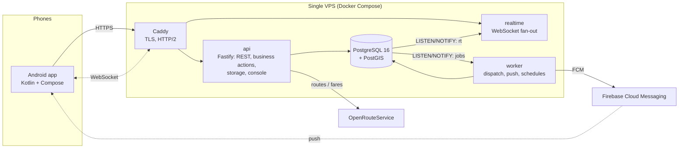

# Call Me Taxi: Ride-Hailing Platform Engineering Case Study

> A ride-hailing platform live in Yangon: a native Android app for customers, drivers and operations staff (about 1,000 drivers), with **callme-core**, the self-hosted backend I built to replace a managed Backend-as-a-Service.
> It runs realtime dispatch, live trip tracking and wallet settlement on a single 6 vCPU / 12 GB server.

This repository is the **public case study** of the project: architecture, design decisions, security model and the production problems that were diagnosed and fixed. The application and backend source are private. Qualified reviewers can ask for a guided code walkthrough.

---

## Results in numbers

| | Before | After |
|---|---|---|
| Time until the **last** of ~1,090 drivers sees a new order | 3.5 – 4.3 s | **1.0 – 1.2 s** (single bulk write instead of 1,090 inserts) |
| Orders lost right after a backend deploy (live drill) | 2 of 2 orders reached nobody | **0**: 3 of 3 cold-start and warm drills passed |
| Idle job-queue queries per minute | ~2,900 | **183** (NOTIFY-driven wake-up + one safety poll) |
| Chat sync calls per minute per active phone | 27 | **7** (delta sync on foreground) |
| Phones with a wrong clock (seen: **77 s** ahead) | orders hidden, early accept, GPS refused | handled: every business time is stamped by the server |
| Hosting | managed Backend-as-a-Service with per-request billing | **one 6 vCPU / 12 GB VPS** (upgraded from 4 vCPU / 8 GB) |
| Load test (copy of production data) | — | **200 active drivers: 0 server errors, every simultaneous accept had exactly one winner**; 500 drivers with the load generator off the server: 0 errors, CPU-bound on 4 vCPU, and two API processes halved the latency (GPS write p50 963 → 205 ms) |
| 80-order continuous FCM & realtime audit (40 app + 40 customer) | 8 silent push/popup bugs exposed before audit | **0 failed pushes, 0 suppressed recipients, 0 dead jobs** across offer → accept → chat → cancel/complete |

---

## What the platform does

- **Customers** book with a pickup only or pickup + destination. Pickup + destination gets a fixed, road-route-based price. Customers follow the driver live on a map and chat with the driver; demands the driver adds (extra cargo, airport, ...) show up live in the price.
- **Drivers** hear new orders (voice notes included) with a fair accept lock, run the trip meter, settle trips into a wallet and see their earnings.
- **Operations staff** (Super Admin / Admin / Monitor) review and release customer orders, run a database console, manage users, wallets, pricing, time-of-day boosts and announcements.

---

## Architecture

- **api**: an HTTP API with document-style endpoints (list/query/create/update), file storage and a single *business action* endpoint. Every action validates the session, role and order state before it writes.
- **realtime**: WebSocket server. Every committed write is published once through Postgres `NOTIFY`, then filtered per socket by that user's read rules. Coalescing keeps GPS bursts bounded per driver.
- **worker**: a durable job queue in Postgres (`FOR UPDATE SKIP LOCKED`) that wakes on `NOTIFY`. It runs dispatch waves, push delivery and scheduled maintenance.
- **migrate**: versioned SQL migrations, applied on every deploy.

More detail: [docs/ARCHITECTURE.md](docs/ARCHITECTURE.md).

---

## Engineering highlights

**Dispatch that is fair and provably fast** ([docs/DISPATCH.md](docs/DISPATCH.md))
- VIP and free drivers hear an order first and drivers already on a trip 5 s later.
- Accept stays locked for *voice note + 3 s* (VIP: 0 s). The lock is enforced on the server, so an old app cannot bypass it.
- A winner's identity stays hidden until every other driver's lock has ended.
- Distance orders expand 1 → 2 → 3 → 4 km, then go citywide.
- Customer orders go to **one driver at a time, nearest first**, skipping empty rings instantly.

**Correct under concurrency and bad networks**
- Accept, cancel and settlement are transactional, with retries on serialization conflicts.
- Stable operation keys make retried requests idempotent.
- The realtime socket is re-established with the new session token on login, so a socket opened a moment too early cannot stay anonymous.

**Time you can trust**
- The server stamps order, alert and GPS times.
- Phones send *how old* a GPS fix is, measured on their monotonic clock, instead of a wall-clock time.
- The app learns the server-clock offset from every response.

**Observability built in**
- The worker logs one line per order event: queued delay, run time, offers created, pushes sent and failed.
- Push failures are grouped by FCM error code.
- The driver's live-position feed logs once a minute whether each fix was accepted, or why it was refused.

**Operations**
- Daily off-site backups (database dump + uploaded files) with a size check after upload and 30-day retention.
- A 5-minute health monitor alerts to Telegram on downtime, restarts, disk, memory, backup age and p95 latency.
- One-command upgrades keep the previous release on disk for rollback.

**Security by design** ([docs/SECURITY_DESIGN.md](docs/SECURITY_DESIGN.md))
- Hashed session tokens and device binding.
- Per-collection read/write policies on every endpoint *and* on the realtime stream.
- Argon2-protected admin console with an audit log and a read-only SQL role.
- Secrets live only on the server (never in the app, in git or in chat).
- Firewall and fail2ban are configured on the host.

---

## November 2026: second hardening round

Measured, not estimated: every item below was verified with tests on real PostgreSQL, an end-to-end run on a scratch copy of the stack, or on a real phone.

- **One backend for two companies.** Call Me and its sister product share one monorepo; 50 files must stay byte-identical and a pre-commit check enforces it, so a fix in one product cannot silently drift from the other. Each company still runs on its own server.
- **Deploys that can undo themselves.** Database dump first, new image, readiness gate, automatic rollback to the kept previous image. Restore drills rebuild a scratch database from the backup and compare row counts, wallet sums and migrations with live.
- **Durable jobs.** A Postgres job queue with per-attempt lease tokens: a worker that dies mid-job cannot complete or double-run someone else's lease.
- **Identity rules owned by the server.** One live account per phone number in any format (`09…`, `+959…`); a permanently banned phone stays banned even after its account is deleted; deleted User IDs are never handed out again, and trips of a deleted person stay in history, labelled *(Deleted)*.
- **Passcodes** are argon2id on the server; admin-console sessions are stored hashed in the database, so several API processes and restarts share them.
- **Real-phone testing found what unit tests could not:** the release build crashed at launch because resource shrinking removed the crash reporter's build ID. Fixed with a keep rule, verified on the phone. Every app coroutine now runs under a crash guard that reports instead of killing the app.
- **Hosts:** SSH key-only (password login refused), firewall and fail2ban, Telegram alerts for dead jobs, worker heartbeat, disk and backup age.

---

## November 2026: two companies, one network

- **Cross-company order transfer with commission settlement.** A driver or staff member can hand an unaccepted order to the sister company. The original company fixes the commission by its own rules and sends it with the order; the accepting driver pays it from their wallet exactly as for a local order and collects it in the fare. A driver who created the order is credited at once; for staff orders the commission is kept as a record. Both companies keep a mirrored ledger, and settlement nets the two directions while storing the original totals next to the net. An Admin of each company must approve; Super Admins can only view.
- **Money over an unreliable link.** Companies talk over an HMAC-signed, replay-protected peer link with an ordered outbox: a peer outage delays a message but never loses or doubles money, and a settlement the other side cannot match exactly is refused and released.
- **Verified with both real backends.** A simulation boots both companies' real code against a temporary PostgreSQL and drives transfers, wallets, settlement and re-delivered messages through the signed link.
- **Edge network.** Traffic now enters through a CDN/WAF edge. The servers accept web traffic only from the edge, the real client IP is restored for rate limits, and health checks verify the origin certificate directly. This also fixed riders whose mobile network could not reach the server address.
- **Worst-case burst test.** 200 drivers online with live sockets and GPS; at the same instant 30 app orders, 50 manual trips and 20 customer bookings, each driven to the end of the trip, on a scratch copy of production data. It found three problems, now fixed: order-number allocation retried itself into failures (now taken in turns), dispatch jobs waiting between waves used up the worker slots (12 → 48), and a 15 s socket timeout dropped queued requests.
  - Call Me: **100 of 100 flows completed, 0 errors.** The burst first exposed that every app order was offered to all ~1,100 registered drivers (1,326 offer rows per order); orders now go only to drivers who are online (presence within 5 minutes) plus staff, as on the sister product: 207 offer rows per order. On the single 4 vCPU server that also hosted the load generator, a 30-orders-in-one-second burst still takes ~34 s median to reach a driver (one order alone: 3.3 s). The live system stayed responsive during the test (~0.2 s median).
  - Sister product on the same platform: 100 of 100 flows, 0 errors.

---

## Late November 2026: push reliability, live admin escalation & cross-company distance dispatch

- **80-order continuous push & realtime audit.** Ran 40 app orders and 40 customer bookings end-to-end (offer, accept, private chat, cancel, complete) against an isolated scratch copy of live data with a push capture sink. Found and fixed 8 production delivery bugs (including customer acceptance audience filtering, missing smart-offer metadata on global order pushes, stale bystander popups after pending cancel/freeze, customer own-order routing, and cross-account token collisions) — post-fix audit: **0 failed pushes, 0 suppressed recipients, 0 dead jobs**.
- **Fresh-login first-order popup reliability.** Claiming a device's FCM token is now atomic across accounts on login (clearing stale ownership on shared phones) and the realtime stream explicitly publishes `DispatchOffer` updates, eliminating missed popups immediately after a fresh sign-in.
- **One-tap live Admin escalation in Private Chat.** Drivers and customers can tap *Connect with Admin* inside any active trip chat. Operations staff (Super Admin, Admin, Monitor) receive an FCM alert, a Notification Center entry, and a live **Support Chat** escalation inbox backed by an active-trip join — staff can reply live inside both local and cross-company trip chats, and escalations clear automatically as soon as the trip completes or cancels.
- **Cross-company Distance Order transfer.** Distance orders can now be transferred to the sister company carrying their pickup coordinates (`dispatch center` + `pickup` coordinates); the receiving company applies **its own** distance ring rules rather than the sender's, while the originating company dismisses stale driver popups cleanly.
- **Universal cancellation finance & arrival lock.** Unified order cancellation settlement (*No Fee*, *2,000 Ks driver compensation*, *commission deduction*) across local and transferred orders with a dedicated transfer penalty ledger, locked automatically once the driver arrives or departs.
- **Edge mTLS & Compose UI smoothness.** Hardened Caddy with **Cloudflare Authenticated Origin Pulls (mTLS)**, strict security headers, and IPv6 origin firewalling; fixed Notification Bell and Chat Bell reliability edge cases and polished Jetpack Compose responsiveness with off-main-thread media decoding and recomposition isolation (268 Android unit tests; 66 shared backend modules enforced byte-identical across both companies).

---

## Selected production incidents

Each one is written up with symptom → evidence → root cause → fix → verification in [docs/ENGINEERING_CASE_STUDY.md](docs/ENGINEERING_CASE_STUDY.md).

1. **"Some orders don't ring."** A 60-second recipient cache, combined with a token clean-up, wiped the *new* push token of drivers who had just signed in again.
2. **Orders reached nobody after a deploy.** The cold-start path was reproduced with a live drill against production, using synthetic drivers with real users' push tokens set aside.
3. **The last drivers heard orders 4 s late.** Per-driver inserts were replaced with one bulk write: 1.0 s end to end.
4. **The customer saw no car.** A driver phone clock 77 s ahead made every GPS fix look "from the future"; the server refused them all.
5. **Distance dispatch silently stopped.** A read inside an event transaction saw its own staged write.
6. **The worker ran out of heap every ~3.5 h.** Idle poll waiters were never released.

---

## Technology

| Layer | Choices |
|---|---|
| Android | Kotlin, Jetpack Compose, Material 3, coroutines/Flow, Google Maps SDK, Fused Location, FCM, R8 |
| Backend | Node.js 22, Fastify, `pg`, firebase-admin, argon2, node:test |
| Data | PostgreSQL 16 + PostGIS, `pg_stat_statements`, UNLOGGED table for high-rate driver positions |
| Realtime | WebSocket, Postgres `LISTEN/NOTIFY`, per-socket authorization, write coalescing |
| Infra | Docker Compose, Caddy (automatic TLS), ufw, fail2ban, systemd timers |
| External | Firebase Cloud Messaging, OpenRouteService (road routes and fares), Google Maps |

## Repository guide

| Document | What it covers |
|---|---|
| [ARCHITECTURE.md](docs/ARCHITECTURE.md) | Components, data model, request and event flow, deployment |
| [DISPATCH.md](docs/DISPATCH.md) | Dispatch rules, accept lock, sequential customer dispatch, fares |
| [ENGINEERING_CASE_STUDY.md](docs/ENGINEERING_CASE_STUDY.md) | Six production incidents, investigated and fixed |
| [MIGRATION.md](docs/MIGRATION.md) | Moving a live app from a managed BaaS to its own backend without changing user experience |
| [SECURITY_DESIGN.md](docs/SECURITY_DESIGN.md) | Threat model, authentication, authorization, secrets, host hardening |
| [OPERATIONS.md](docs/OPERATIONS.md) | Deploy, rollback, backups, monitoring, testing strategy |
| [SECURITY.md](SECURITY.md) | What this public repository deliberately does not contain |

Sister product on the same platform: [Mingalarpar Taxi](https://github.com/ywtzdev/mingalarpar-taxi-showcase).

---

© 2026. Portfolio material, see [LICENSE.md](LICENSE.md). The production application and backend are proprietary.
